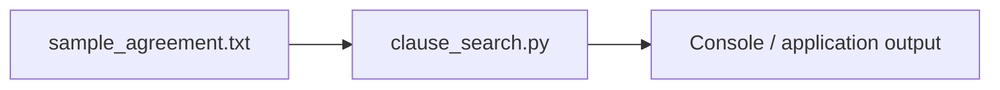

# Architecture — Contract Clause Search Engine

## Inputs

- `sample_contracts/sample_agreement.txt`

## Source files

- `src/clause_search.py`

## Output

This representation is intended for source navigation. It does not imply a production deployment or undisclosed components. The editable diagram is available as [`architecture.mmd`](architecture.mmd).
